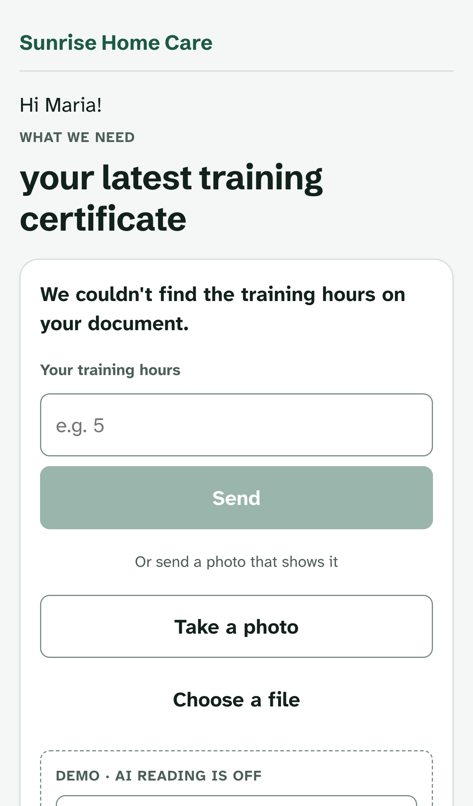

# PaperEase

**Less chasing. More caring.**

PaperEase is an AI agent that collects compliance documents from home care caregivers over SMS. It is built for California home care organizations (HCOs). The agent finds missing or expiring documents, texts the caregiver, reads the photo they send back, and asks follow-up questions. It then prepares a record for a person to verify and approve.

Built as a hackathon MVP. The full flow runs end to end with no API keys and no database.


## Features

- **Gap detection:** checks every caregiver against the requirement checklist and flags documents that are missing or expiring.
- **SMS outreach:** the agent requests documents in the caregiver's language (English, Spanish, Tagalog, Vietnamese or Chinese) and sends reminders. Texts are simulated until Twilio is configured (see below).
- **Caregiver upload link:** every request text carries a secure link to a phone-friendly page. Caregivers see what is needed, take a photo and answer the agent's question there, with no app or login. What they send fills in the agency's record the same way an SMS reply does.
- **AI extraction:** reads the photo the caregiver sends and fills in each field with a confidence score and a pointer to where on the document it was found.
- **Photo checks in messages:** shows each attachment's preliminary result and next step, with a detailed checklist available in the conversation.
- **Follow-ups:** when a required field is missing, the agent asks the caregiver and reads the answer from their reply.
- **Daily sweep:** every morning the agent re-checks expiry dates and reminds caregivers who have not replied. Requests that stay silent go to a person. It can also request new gaps on its own if you turn that on.
- **Exception handling:** escalates to a person for blurry photos, name mismatches, too few training hours, wrong documents and opt-outs.
- **Human approval:** a person verifies or corrects every field before a record can be approved.
- **Audit trail:** every action by the agent, the admin and the caregiver is logged in order.
- **Audit-ready personnel files:** one printable file per caregiver with originals, who confirmed each field, the registry result and a readiness score (below).
- **Compliance gate API:** scheduling software asks whether a caregiver can work a shift (below).
- **Credential wallet:** with the caregiver's consent, confirmed records pre-fill their file at another agency (below).




## Quick start

Requires Node.js 20 or later.

```bash
npm install
npm run dev        # http://localhost:3000
```

On first run the app creates `data/db.json` with 6 sample caregivers. To start over, click **Reset demo data** on the Rules screen or run `npm run reset`.

## Demo walkthrough

1. On the dashboard, Maria Lopez's **Entry training** is **Missing**. Click her row.
2. Click **Ask agent to request**. The agent texts Maria and the status becomes **Requested**.
3. On the simulated phone at the right, choose **Entry training** under **Check document for**, then send the **Training certificate, hours not shown (Maria)** sample photo. Its message shows **More information needed** and a suggested next step. Expand **View checks** to inspect the detailed result. The agent sees the hours are missing and asks a follow-up. The status becomes **Following up**.
4. Reply with the **It was 5 hours** chip. The agent reads the hours from the reply and prepares the record. The status becomes **Pending review**.
   Instead of steps 3 and 4 you can tap the link in the agent's text. It opens the caregiver's page, where you can send the sample document and answer the question the way a caregiver would.
5. **Verify** or **Correct** each field. Once every field is confirmed, **Approve record** turns on. Approve it, then check the audit trail.

Other cases to try:

| Try this | What happens |
| --- | --- |
| Luis is already **Escalated** for a blurry photo. Request again and send **HCA registration, clear photo** | The agent extracts the registration |
| Send a document with someone else's name | Escalated for a name mismatch |
| Reply `I did 3 hours` | Escalated for falling short of the 5-hour minimum |
| Send a TB result instead of a training certificate | The agent asks for the right document |
| Reply `STOP` | The caregiver is opted out and open requests go to staff |
| Open Ana or Luis | The conversation is in Spanish |

## Configuration

Everything is optional. Copy `.env.example` to `.env.local` and fill in what you need.

| Variable | Used for |
| --- | --- |
| `ANTHROPIC_API_KEY` | Claude reads documents, writes SMS copy and interprets replies |
| `PAPEREASE_MODEL` | Claude model (default `claude-opus-5-5`) |
| `RUNANYWHERE_BASE_URL`, `RUNANYWHERE_API_KEY`, `RUNANYWHERE_MODEL` | Follow-up question copy through RunAnywhere (OpenAI-compatible) |
| `SUPABASE_URL`, `SUPABASE_SECRET_KEY` | Store data and uploads in Supabase instead of local files |
| `SUPABASE_PUBLISHABLE_KEY` | Turns on admin sign-in with Supabase Auth |
| `PAPEREASE_LINK_SECRET` | Signs the caregiver upload links. Required in production |
| `CRON_SECRET` | Protects `/api/cron`, the daily sweep endpoint. Without it the endpoint refuses every call |
| `REGISTRY_PROVIDER` | California HCA registry check: `demo` (default) or `manual` |
| `PAPEREASE_DATA_DIR` | Where the local JSON store and uploads live (default `./data`) |

### AI

Each AI feature falls back to deterministic behavior when no key is set or a call fails.

| Feature | With keys | Without keys |
| --- | --- | --- |
| Document extraction | Claude vision with structured output reads sample and uploaded photos | Preset results for each sample document. Your own uploads are escalated for a person to read |
| SMS copy | Claude, based on templates | English and Spanish templates |
| Follow-up questions | RunAnywhere if configured, otherwise Claude | Templates |
| Reply interpretation | Claude | Number and date rules |

SMS is simulated unless Twilio is configured; see [Real text messages](#real-text-messages).

### Admin sign-in

With `SUPABASE_URL` and `SUPABASE_PUBLISHABLE_KEY` set, every admin page and API route needs a signed-in admin. Decisions in the audit trail carry that person's name. The caregiver's upload page, its API and the cron endpoint stay public; each checks its own token or secret.

There is no sign-up page. An account is an admin only when its Supabase `app_metadata.role` is `admin`, which only the secret key can set:

```bash
npm run admin:add -- dana@example.com "Dana Park"   # prints a password once; run it again to reset
```

Without Supabase (the local JSON demo) there is no sign-in.

### Caregiver upload links

Request, reminder and follow-up texts end with a link to `/u/<token>`. The token is signed with `PAPEREASE_LINK_SECRET` and scoped to one open request. It expires after 72 hours, and as soon as the request moves on, for example when the office asks for another document. The page shows only the caregiver's first name, the agency and the document requested. Uploads go through the same checks and storage as everything else.

In demo mode (no `ANTHROPIC_API_KEY`) uploaded photos cannot be read, so the page also offers the sample documents, labeled as a demo.

### Photo checks in messages

Choose an open document request and use **Send sample photo** for a sample, or **Upload your own photo** for an image (up to 5 MB). Upload and analysis progress appear in the composer, followed by the result and a suggested next step beside that attachment. Expand **View checks** to see the detailed checklist. Each result is saved with its message; later replies do not rewrite the earlier photo's result.

The checks cover readability, requested document type, caregiver name, reading confidence, required information and training hours where applicable. The outcome is one of **Ready for staff review**, **More information needed**, **Staff review needed** or **Not checked**. A pass means that a preliminary check passed; it does not establish document authenticity or final approval.

Real image analysis uses the existing Anthropic configuration. Sample fallbacks are explicitly labeled **Demo result**. An uploaded image with no configured AI, an analysis failure, or an unsupported PDF is marked **Not checked** and left for staff; it is never treated as a successful check. PDFs remain available as original attachments for manual review.

The `caregiver-reply` action accepts `requirementId` to route the reply to an open request. When several requests are open, this is required: the agent does not guess which record a photo belongs to. Closed or invalid targets are left unassessed. SMS opt-out and consent also apply to photo collection. Photo checks are preliminary; a person still verifies the fields and approves the record.

Photo-check cases to try without AI keys:

| Sample or action | Photo-check result |
| --- | --- |
| Maria's **Training transcript with hours** for Entry training | **Ready for staff review**; every extracted field still needs a person's verification |
| Maria's **Training certificate, hours not shown** | **More information needed**; provide the missing training hours |
| A document with another caregiver's name, or a blurry sample | **Staff review needed**; mismatches or unreadable content are flagged |
| A TB result for an Entry training request | **More information needed**; send the requested document |
| Upload your own image without an AI key, or upload a PDF | **Not checked**; staff must read the original attachment |

### Daily sweep

Once a day the agent:

1. Re-checks expiry dates and flags documents that are expiring or expired.
2. If **automatic requests** are on in Rules, texts caregivers about new gaps. They are off by default, so the agent only texts about gaps an admin has asked it to collect.
3. Sends a reminder for any open request with no reply after the configured number of days.
4. Escalates to a person once the reminder limit is reached. A caregiver's reply restarts the count.

`vercel.json` runs it through Vercel Cron at 16:00 UTC (9 AM in California during daylight saving time). Vercel sends `Authorization: Bearer $CRON_SECRET`; any other scheduler can call `GET /api/cron` the same way. To run it by hand, click **Run daily sweep now** on the dashboard.

### Supabase

With `SUPABASE_URL` and `SUPABASE_SECRET_KEY` set, the app stores its data in Supabase tables. Uploaded photos go to a private `uploads` Storage bucket. The secret key is only used on the server. Every table has RLS turned on with no policies, and files are served through `/api/files`.

```bash
npx supabase link --project-ref <your-project-ref>
npx supabase db push      # creates the tables and bucket from supabase/migrations
npm run db:seed           # copies data/db.json (or the sample data) into Supabase
```

With Supabase on, **Reset demo data** resets the Supabase tables. `npm run reset` only deletes the local JSON file.

## California HCA registry check

When a Home Care Aide registration is submitted, the agent looks the aide up on the California Home Care Aide Registry (CDSS) using the caregiver's name on file and the number from the document. The registry search needs first name, last name and PER ID / HCA ID, and returns one of 8 statuses.

- `REGISTERED` and `REGISTERED*` (registered with an exemption) pass. `REGISTERED-PENDING REVIEW`, `PENDING`, `CLOSED`, `DENIED`, `FORFEITED` and `REVOKED` stop the record and escalate it to staff. No match (a misread number, or a name that disagrees with the registry) also escalates.
- Approve stays disabled until the registry check passes, on top of every field being verified. If staff correct the number, the check re-runs and releases or stops the record.
- Choose a provider with `REGISTRY_PROVIDER`: `demo` (default; a built-in sample registry) or `manual` (staff search the [CDSS registry](https://www.ccld.dss.ca.gov/hcsregistry/registrysearch.aspx) and record what it shows).
- In demo mode, correct a record's registration number to try each outcome: `DEMO-EXEMPT`, `DEMO-REVIEW`, `DEMO-PENDING`, `DEMO-CLOSED`, `DEMO-DENIED`, `DEMO-FORFEITED`, `DEMO-REVOKED` (any name), or `ZZZ99999` for no match.
- There is no provider that calls the CDSS website. It has no documented API, its Conditions of Use were not reviewed, and the ID format is not published, so ID validation is deliberately loose. Get CDSS's OK before automating (HCSB@dss.ca.gov).
- Supabase: run `supabase/migrations/20261017000005_registry_check.sql` (adds `submissions.registry_check`).
- `npm test` runs the registry and agent-flow tests.

## Validation

```bash
npm run test:all
npm run typecheck
npm run build
```

`npm run test:photo` runs the 31 photo-check and workflow cases; `npm run test:all` also includes the regulatory tests. Photo coverage includes document routing, missing fields, mismatches, unavailable analysis, manual approval and a mocked Supabase message roundtrip. Both commands use a shared preload that disables provider and Supabase credentials and sets test mode before every worker starts. The suites use deterministic fixtures and separate temporary data directories; they do not make model calls or change the demo's saved records. The existing `npm test` command remains available for the regulatory suite. The `tsx` dependency runs the tests and database seeding script.

## Audit-ready personnel files

California inspects home care organizations without notice. Every caregiver page has a **Personnel file for audit** button, and **Audit readiness** in the menu ranks every caregiver by what would stop their file passing.

A file is audit ready only when, for each requirement, a person approved the record, every field was confirmed by a person, the original is attached (staff-collected items such as the background check are exempt), nothing has expired on the audit date, and, for the Home Care Aide registration, the registry lookup shows an active registration. The score is the share of requirements that meet all of that. The file is one self-contained page: originals embedded with their SHA-256, who confirmed each field, the registry result, version history, the activity log and a fingerprint. Exports are written to the audit trail. Grace Okafor's sample file passes; the other sample caregivers show what a failing file looks like.

## Compliance gate API

Scheduling software calls `POST /api/v1/eligibility` with a caregiver and a shift and gets eligible, ineligible or unknown with reason codes. It is off until `ELIGIBILITY_API_KEYS` is set. See [docs/ELIGIBILITY_API.md](docs/ELIGIBILITY_API.md).

## Credential wallet

Caregivers often work for several agencies. On a caregiver page, **Ask to add records** texts the caregiver; if they reply YES, the values a person already confirmed (never the photos) go to a shared wallet keyed by a hash of their phone number. At another agency, **Check for earlier records** texts them again; on YES their file is pre-filled with the values marked "From wallet", and a person there still confirms each field while the registry is checked again. STOP removes what an agency shared. In the demo, Luis Hernández has a sample record from "Harbor Home Health" waiting: use **Check for earlier records** on his page and reply `SI`. Set `WALLET_PEPPER` outside local development.

## Real text messages

Set `TWILIO_ACCOUNT_SID`, `TWILIO_AUTH_TOKEN`, `TWILIO_FROM` (or `TWILIO_MESSAGING_SERVICE_SID`), `PUBLIC_BASE_URL` and `SMS_LIVE=true`, and turn on admin sign-in (`SUPABASE_URL` and `SUPABASE_PUBLISHABLE_KEY`); without all of them texts stay in the app. In Twilio, point the number's incoming-message webhook at `<PUBLIC_BASE_URL>/api/sms/inbound` and the status callback at `<PUBLIC_BASE_URL>/api/sms/status`. Photos caregivers text are stored and read like any other upload. Languages live in `lib/languages.ts`; Tagalog, Vietnamese and Chinese copy is machine-drafted and flagged until a native speaker reviews it.

Security details and gaps: [docs/SECURITY.md](docs/SECURITY.md).

## Project structure

| Path | What it does |
| --- | --- |
| `lib/agent.ts` | Agent workflow and every action: gap detection, requests, replies, verification, approval, rejection, rule changes |
| `lib/llm.ts` | Claude and RunAnywhere calls with fallbacks |
| `lib/photo-check.ts` | Per-attachment checks and preliminary outcomes |
| `lib/db.ts` | Storage for data (`load()`/`save()`) and uploads (`writeUpload()`/`readUpload()`), in Supabase or local files |
| `lib/registry.ts`, `lib/registry-providers.ts` | California HCA registry check: status rules, demo and manual providers |
| `lib/packet.ts`, `lib/packet-files.ts` | Audit-ready personnel file builder, readiness score and printable renderer |
| `lib/eligibility.ts`, `lib/apikeys.ts`, `lib/api-v1.ts` | Shift eligibility decision, API keys and shared API plumbing (`app/api/v1`) |
| `lib/wallet.ts` | Credential wallet: consent, publish, import |
| `lib/sms.ts`, `lib/sms-inbound.ts`, `lib/languages.ts` | Twilio sending, signed webhooks, per-language message copy |
| `lib/seed.ts` | Requirement checklist and sample data |
| `app/u/[token]/` | The caregiver's upload page |
| `lib/links.ts`, `lib/caregiverLink.ts` | Signed upload links and what the caregiver's page shows |
| `app/` | Next.js pages (dashboard, caregiver detail, audit trail, rules) and API routes, including `api/cron` for the daily sweep |
| `components/` | UI components and the client data hook |
| `components/PhotoCheckCard.tsx` | Compact message-thread result with expandable check details |
| `supabase/migrations/` | Postgres tables and the Storage bucket |
| `tests/` | `npm test`: registry rules and agent-flow tests |
| `scripts/seed-supabase.ts` | Copies the local store into Supabase and checks the round trip |
| `scripts/make-samples.mjs` | Generates the sample document images with Playwright |
| `tests/` | Offline photo-check and persisted workflow tests |

## Design principles

- **A person approves every record.** The approve button stays off until a person has verified every field. The agent never approves on its own.
- **AI values look different from verified ones.** Values from AI extraction or SMS replies are shown in blue. Only values a person has verified turn green.
- **No sensitive data over SMS.** Background checks (Live Scan) are handled by staff, and the agent never asks for sensitive identifiers by text.
- **Nothing is overwritten.** Original documents and earlier submissions are kept.

## Disclaimer

The requirement checklist in `lib/seed.ts` is a simplified demo version. Check it against current California Home Care Services Bureau requirements before using it for real compliance work. All people, phone numbers and documents in the sample data are fictional.

## Nationwide regulatory watch

The new `/regulatory` workspace adds a 50-state source registry, durable monitoring jobs, RunAnywhere extraction with cited evidence, agency/worker onboarding, rule review and adoption, and a private evidence checklist. The original dashboard remains a separate demonstration.

For a presentation, run `npm run demo`, open `http://127.0.0.1:3000/regulatory`, and click **Reset guided demo**. This clearly labelled simulated policy scenario requires no account or API spend and does not touch Supabase team data.

See [the demo and operational guide](docs/regulatory-demo.md) for live Supabase setup, worker commands, verification, and current coverage boundaries. Use Node 24 or later.
