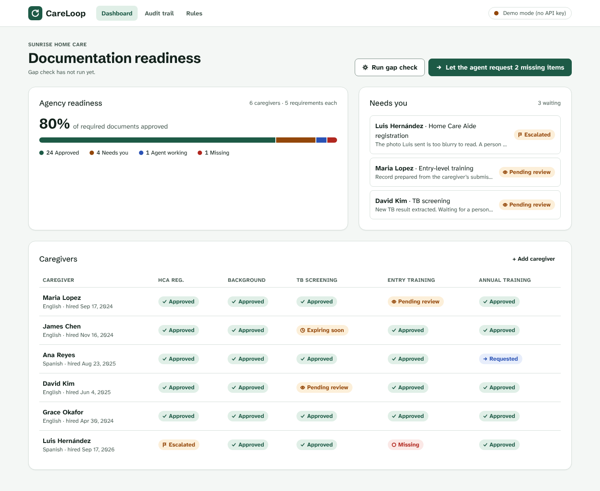
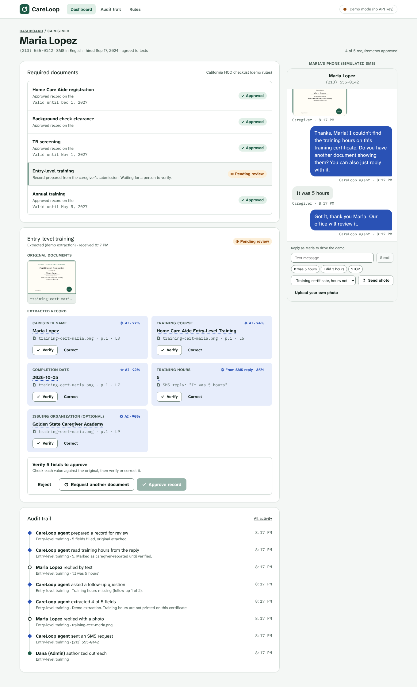

# CareLoop AI

**Less chasing. More caring.**

CareLoop is an AI agent that collects compliance documents from home care caregivers over SMS. It is built for California home care organizations (HCOs). The agent finds missing or expiring documents, texts the caregiver, reads the photo they send back, and asks follow-up questions. It then prepares a record for a person to verify and approve.

Built as a hackathon MVP. The full flow runs end to end with no API keys and no database.



## Features

- **Gap detection:** checks every caregiver against the requirement checklist and flags documents that are missing or expiring.
- **SMS outreach:** the agent requests documents in the caregiver's language (English or Spanish) and sends reminders.
- **AI extraction:** reads the photo the caregiver sends and fills in each field with a confidence score and a pointer to where on the document it was found.
- **Follow-ups:** when a required field is missing, the agent asks the caregiver and reads the answer from their reply.
- **Exception handling:** escalates to a person for blurry photos, name mismatches, too few training hours, wrong documents and opt-outs.
- **Human approval:** a person verifies or corrects every field before a record can be approved.
- **Audit trail:** every action by the agent, the admin and the caregiver is logged in order.



## Quick start

Requires Node.js 20 or later.

```bash
npm install
npm run dev        # http://localhost:3000
```

On first run the app creates `data/db.json` with 6 sample caregivers. To start over, click **Reset demo data** on the Rules screen or run `npm run reset`.

## Demo walkthrough

1. On the dashboard, Maria Lopez's **Entry training** is **Missing**. Click her row.
2. Click **Ask agent to request**. The agent texts Maria and the status becomes **Requested**.
3. On the simulated phone at the right, send the **Training certificate, hours not shown (Maria)** photo. The agent extracts 4 fields, sees the hours are missing and asks a follow-up. The status becomes **Following up**.
4. Reply with the **It was 5 hours** chip. The agent reads the hours from the reply and prepares the record. The status becomes **Pending review**.
5. **Verify** or **Correct** each field. Once every field is confirmed, **Approve record** turns on. Approve it, then check the audit trail.

Other cases to try:

| Try this | What happens |
| --- | --- |
| Luis is already **Escalated** for a blurry photo. Request again and send **HCA registration, clear photo** | The agent extracts the registration |
| Send a document with someone else's name | Escalated for a name mismatch |
| Reply `I did 3 hours` | Escalated for falling short of the 5-hour minimum |
| Send a TB result instead of a training certificate | The agent asks for the right document |
| Reply `STOP` | The caregiver is opted out and open requests go to staff |
| Open Ana or Luis | The conversation is in Spanish |

## Configuration

Everything is optional. Copy `.env.example` to `.env.local` and fill in what you need.

| Variable | Used for |
| --- | --- |
| `ANTHROPIC_API_KEY` | Claude reads documents, writes SMS copy and interprets replies |
| `CARELOOP_MODEL` | Claude model (default `claude-opus-5-5`) |
| `RUNANYWHERE_BASE_URL`, `RUNANYWHERE_API_KEY`, `RUNANYWHERE_MODEL` | Follow-up question copy through RunAnywhere (OpenAI-compatible) |
| `SUPABASE_URL`, `SUPABASE_SECRET_KEY` | Store data and uploads in Supabase instead of local files |
| `CARELOOP_DATA_DIR` | Where the local JSON store and uploads live (default `./data`) |

### AI

Each AI feature falls back to deterministic behavior when no key is set or a call fails.

| Feature | With keys | Without keys |
| --- | --- | --- |
| Document extraction | Claude vision with structured output reads sample and uploaded photos | Preset results for each sample document. Your own uploads are escalated for a person to read |
| SMS copy | Claude, based on templates | English and Spanish templates |
| Follow-up questions | RunAnywhere if configured, otherwise Claude | Templates |
| Reply interpretation | Claude | Number and date rules |

SMS is simulated. To connect Twilio, send from `Ctx.sms()` in `lib/agent.ts` and route inbound webhooks to the `caregiver-reply` action.

### Supabase

With `SUPABASE_URL` and `SUPABASE_SECRET_KEY` set, the app stores its data in Supabase tables. Uploaded photos go to a private `uploads` Storage bucket. The secret key is only used on the server. Every table has RLS turned on with no policies, and files are served through `/api/files`.

```bash
npx supabase link --project-ref <your-project-ref>
npx supabase db push      # creates the tables and bucket from supabase/migrations
npm run db:seed           # copies data/db.json (or the sample data) into Supabase
```

With Supabase on, **Reset demo data** resets the Supabase tables. `npm run reset` only deletes the local JSON file.

## Project structure

| Path | What it does |
| --- | --- |
| `lib/agent.ts` | Agent workflow and every action: gap detection, requests, replies, verification, approval, rejection, rule changes |
| `lib/llm.ts` | Claude and RunAnywhere calls with fallbacks |
| `lib/db.ts` | Storage for data (`load()`/`save()`) and uploads (`writeUpload()`/`readUpload()`), in Supabase or local files |
| `lib/seed.ts` | Requirement checklist and sample data |
| `app/` | Next.js pages (dashboard, caregiver detail, audit trail, rules) and API routes |
| `components/` | UI components and the client data hook |
| `supabase/migrations/` | Postgres tables and the Storage bucket |
| `scripts/seed-supabase.ts` | Copies the local store into Supabase and checks the round trip |
| `scripts/make-samples.mjs` | Generates the sample document images with Playwright |

## Design principles

- **A person approves every record.** The approve button stays off until a person has verified every field. The agent never approves on its own.
- **AI values look different from verified ones.** Values from AI extraction or SMS replies are shown in blue. Only values a person has verified turn green.
- **No sensitive data over SMS.** Background checks (Live Scan) are handled by staff, and the agent never asks for sensitive identifiers by text.
- **Nothing is overwritten.** Original documents and earlier submissions are kept.

## Disclaimer

The requirement checklist in `lib/seed.ts` is a simplified demo version. Check it against current California Home Care Services Bureau requirements before using it for real compliance work. All people, phone numbers and documents in the sample data are fictional.
